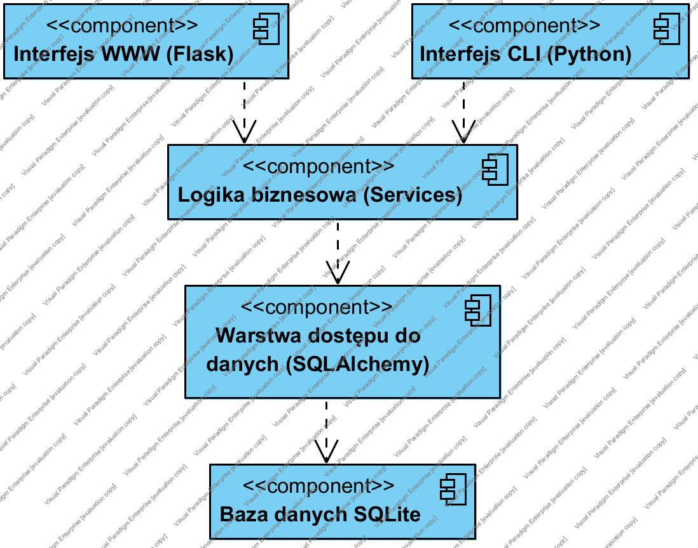
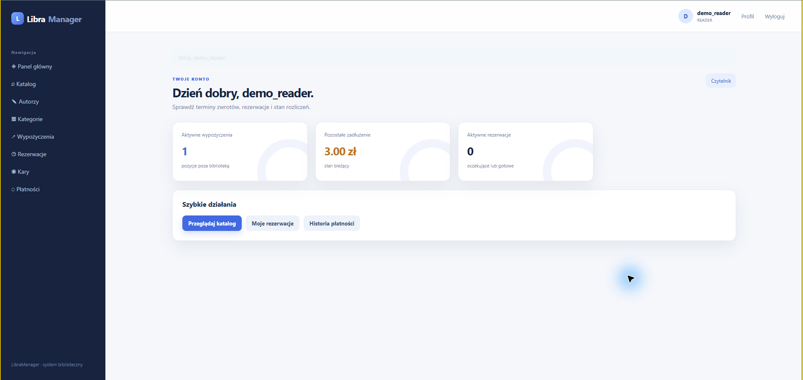

# LibraManager – Library Management System

[Polski](README.md) | **English**

     

## About

LibraManager is a library management system developed as part of a Software Engineering course. It combines a web application and an interactive command-line interface (CLI), sharing the same business logic and database.

**Author: Mateusz Stanikowski**  
**Creation date: November 22, 2026**

## Features

- User, reader and permission management (administrator, librarian, reader).
- Catalogue of books, authors, categories and physical copies.
- Loans, returns and FIFO reservations.
- Fine calculation and cash/card payment recording (no payment processor integration).
- Reports, statistics, CSV export, settings and audit logs.
- Authentication, password hashing, access control and CSRF protection.

## Architecture

```text
Web / CLI
    ↓
Controllers
    ↓
Business services
    ↓
Repositories
    ↓
SQLAlchemy / SQLite
```

The system uses Python, Flask, Flask-SQLAlchemy, SQLite, HTML, CSS, JavaScript and pytest. The business layer contains 15 services and the data model comprises 13 tables. Financial operations use Decimal and transactions, prevent overpayments and apply conditional fine-state updates.



## User interface



## Installation (Windows PowerShell)

Requirements: Git, Python 3.14 and repository access.

```powershell
git clone https://github.com/TheMatX7/LibraManager.git
cd LibraManager
py -3.14 -m venv .venv
.\.venv\Scripts\python.exe -m pip install -r requirements.txt
Copy-Item .env.example .env
$key = .\.venv\Scripts\python.exe -c "import secrets; print(secrets.token_hex(32))"
"SECRET_KEY=$key" | Set-Content .env -Encoding ASCII
```

### Demonstration data

On a new, empty database, run:

```powershell
.\.venv\Scripts\python.exe run.py --seed-demo
```

The generator prints randomly generated demo passwords to the local console and refuses to run again if users already exist. Do not share these passwords. The default database is `database/library.db`.

### Web application

```powershell
.\.venv\Scripts\python.exe run.py
```

Open [http://127.0.0.1:5000/](http://127.0.0.1:5000/). Health endpoint: `/health`.

### CLI

```powershell
.\.venv\Scripts\python.exe run.py --cli
```

## Testing

| Metric | Last reported result |
|---|---:|
| Tests passed | 1750 |
| Services coverage | 97% |
| FineService | 100% |
| PaymentService | 98% |
| ReportService | 98% |

Results are from the technical acceptance report, before the final CSS restoration; they are not a fresh post-publication test run.

```powershell
.\.venv\Scripts\python.exe -m pytest -q
.\.venv\Scripts\python.exe -m pytest --cov=app/services --cov-branch --cov-report=term-missing
```

## Documentation

- [Part I – System design (Polish)](docs/LibraManager_dokumentacja_techniczna.docx)
- [Part II – Implementation and testing (Polish)](docs/LibraManager_Dokumentacja_czesc_II.docx)
- [UML and ERD diagrams](docs/diagrams/)
- [Test report](docs/TEST_REPORT.md) · [Acceptance report](docs/ACCEPTANCE_REPORT.md)
- [User guide](docs/USER_GUIDE.md) · [Presentation guide](docs/PRESENTATION_GUIDE.md)
- [Development progress](docs/DEVELOPMENT_PROGRESS.md) · [Security](docs/SECURITY.md)

## Security and deployment

Do not publish the `.env` file, local databases or passwords. Flask's development server is not intended for production. Use a WSGI server, HTTPS and `SESSION_COOKIE_SECURE=true` in production.

## Copyright

© 2026 Mateusz Stanikowski. All rights reserved.

Code and documentation, to the extent of the author's rights, are not released under an open-source license. See [LICENSE](LICENSE). Third-party dependencies and materials remain subject to their respective licenses.
