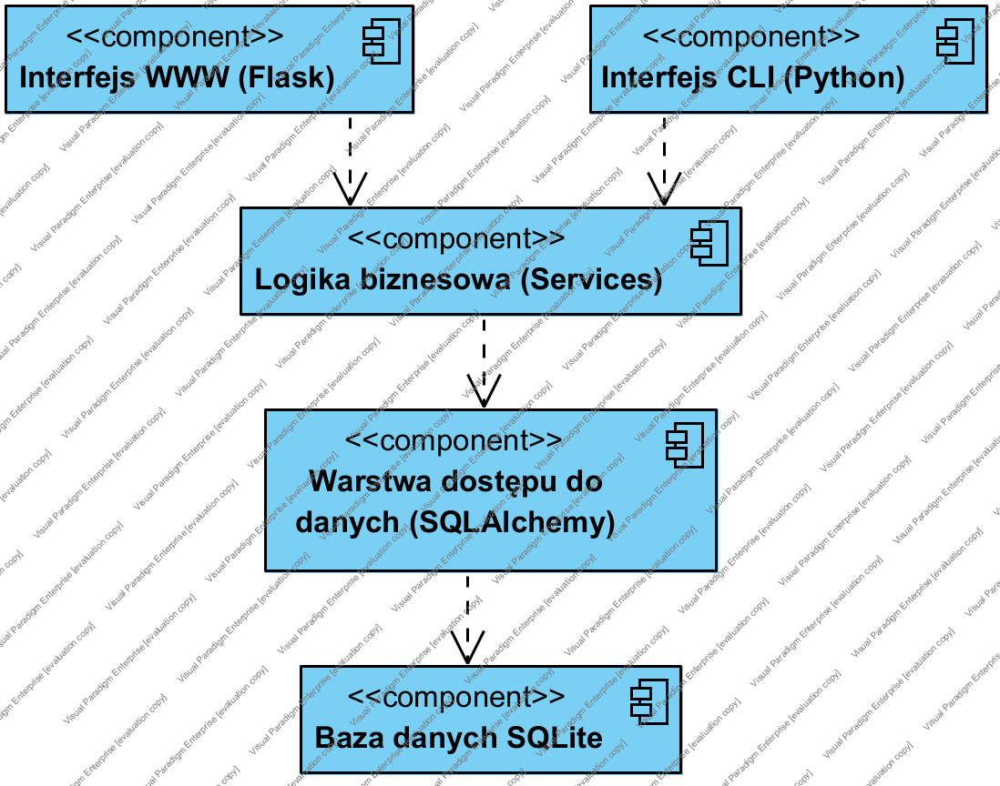
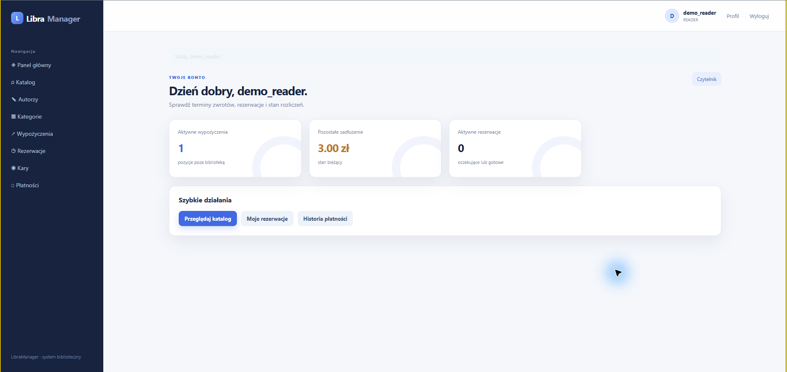

# LibraManager – System zarządzania biblioteką

**Polski** | [English](README.en.md)

     

## O projekcie

LibraManager to system zarządzania biblioteką opracowany w ramach przedmiotu Inżynieria oprogramowania. Łączy aplikację internetową WWW oraz interaktywny interfejs konsolowy CLI, korzystające ze wspólnej warstwy logiki biznesowej i bazy danych.

**Autor: Mateusz Stanikowski**  
**Data utworzenia: 22.11.2026**

## Funkcjonalności

- Zarządzanie użytkownikami, czytelnikami i uprawnieniami (administrator, bibliotekarz, czytelnik).
- Katalog książek, autorów, kategorii i egzemplarzy.
- Wypożyczenia, zwroty, rezerwacje z kolejką FIFO.
- Naliczanie kar i rejestrowanie płatności gotówką lub kartą (bez integracji z operatorem płatności).
- Raporty, statystyki, eksport CSV, ustawienia i dziennik audytu.
- Uwierzytelnianie, haszowanie haseł, kontrola dostępu i ochrona CSRF.

## Architektura

```text
WWW / CLI
    ↓
Kontrolery
    ↓
Serwisy biznesowe
    ↓
Repozytoria
    ↓
SQLAlchemy / SQLite
```

System wykorzystuje Python, Flask, Flask-SQLAlchemy, SQLite, HTML, CSS, JavaScript oraz pytest. Warstwa biznesowa obejmuje 15 serwisów, a model danych 13 tabel. Operacje finansowe wykorzystują Decimal i transakcje, zapobiegają nadpłatom oraz stosują warunkową aktualizację stanu kary.



## Interfejs użytkownika



## Instalacja (Windows PowerShell)

Wymagania: Git, Python 3.14 oraz dostęp do repozytorium.

```powershell
git clone https://github.com/TheMatX7/LibraManager.git
cd LibraManager
py -3.14 -m venv .venv
.\.venv\Scripts\python.exe -m pip install -r requirements.txt
Copy-Item .env.example .env
$key = .\.venv\Scripts\python.exe -c "import secrets; print(secrets.token_hex(32))"
"SECRET_KEY=$key" | Set-Content .env -Encoding ASCII
```

### Dane demonstracyjne

Na nowej, pustej bazie uruchom:

```powershell
.\.venv\Scripts\python.exe run.py --seed-demo
```

Generator wypisze losowo wygenerowane hasła demonstracyjne w lokalnej konsoli i odmówi ponownego uruchomienia, gdy istnieją już użytkownicy. Nie udostępniaj tych haseł. Domyślna baza znajduje się w `database/library.db`.

### WWW

```powershell
.\.venv\Scripts\python.exe run.py
```

Otwórz [http://127.0.0.1:5000/](http://127.0.0.1:5000/). Kontrola stanu: `/health`.

### CLI

```powershell
.\.venv\Scripts\python.exe run.py --cli
```

## Testowanie

| Wskaźnik | Ostatni zgłoszony wynik |
|---|---:|
| Zaliczone testy | 1750 |
| Pokrycie warstwy services | 97% |
| FineService | 100% |
| PaymentService | 98% |
| ReportService | 98% |

Wyniki pochodzą z raportu odbioru technicznego, sprzed końcowego odtworzenia CSS; nie stanowią wyniku nowego uruchomienia testów po publikacji.

```powershell
.\.venv\Scripts\python.exe -m pytest -q
.\.venv\Scripts\python.exe -m pytest --cov=app/services --cov-branch --cov-report=term-missing
```

## Dokumentacja

- [Część I – projektowanie](docs/LibraManager_dokumentacja_techniczna.docx)
- [Część II – implementacja i testowanie](docs/LibraManager_Dokumentacja_czesc_II.docx)
- [Diagramy UML i ERD](docs/diagrams/)
- [Raport testów](docs/TEST_REPORT.md) · [Raport odbioru](docs/ACCEPTANCE_REPORT.md)
- [Instrukcja użytkownika](docs/USER_GUIDE.md) · [Przewodnik prezentacji](docs/PRESENTATION_GUIDE.md)
- [Historia rozwoju](docs/DEVELOPMENT_PROGRESS.md) · [Bezpieczeństwo](docs/SECURITY.md)

## Bezpieczeństwo i wdrożenie

Nie publikuj pliku `.env`, lokalnych baz danych ani haseł. Serwer deweloperski Flask nie jest przeznaczony do produkcji. W środowisku produkcyjnym stosuj serwer WSGI, HTTPS i `SESSION_COOKIE_SECURE=true`.

## Prawa autorskie

© 2026 Mateusz Stanikowski. Wszelkie prawa zastrzeżone.

Kod i dokumentacja w zakresie praw przysługujących autorowi nie są udostępniane na licencji open source. Szczegóły: [LICENSE](LICENSE). Zależności i materiały osób trzecich podlegają własnym licencjom.
